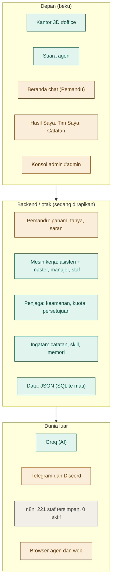
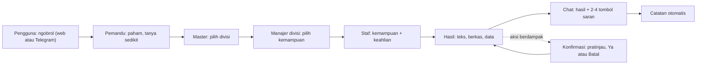
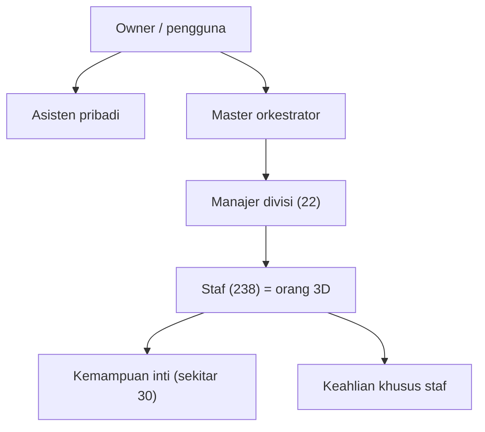

# Fundamental RAIVERSE

Dokumen hidup. Sumber utama diagram ada di berkas ini (blok `mermaid`). Setelah mengubahnya jalankan `node scripts/sync-fundamental.mjs` agar `index.html` ikut diperbarui. Terakhir diperbarui: 2026-11-19.

## 1. Tujuan satu kalimat
Platform "perusahaan AI" yang **sangat sederhana di depan** (ngobrol dan pilih tombol, untuk semua orang) tetapi **sangat kuat di belakang** (agen dan staf yang benar-benar mengerjakan, menghasilkan berkas dan data).

## 2. Prinsip yang sudah diputuskan
1. Satu antarmuka untuk semua orang. Tidak ada mode (bukan Mode Anak, Lengkap, Mahir).
2. Depan dipandu pilihan tombol seperti ChatGPT: ngobrol, AI mengerjakan, di akhir ada saran atau konfirmasi berupa tombol.
3. Bagian depan (kantor 3D `#office`, suara, UI) **dibekukan** karena sudah bagus. Perubahan sekarang ada di backend.
4. Hal teknis (kunci AI, model, MCP, kuota, data, keamanan) hanya di **konsol admin** untuk pengelola, bukan untuk pengguna.
5. Hierarki: Owner → asisten pribadi + master → manajer divisi (22) → staf.
6. **Staf = orang + kemampuan.** 238 staf tetap ada sebagai karakter 3D, tetapi otaknya dipakai bersama lewat sekitar 30 kemampuan inti. Staf = kemampuan inti + keahlian khusus.
7. Eksekusi staf berjalan **native** di RAIVERSE, bukan 221 workflow n8n. n8n hanya untuk jadwal dan pemicu luar.
8. Saluran chat luar: **Telegram dan Discord** (bukan WhatsApp), setiap pengguna di sesinya sendiri.
9. Hasil tidak boleh dipalsukan: bila sesuatu belum tersambung (Sheets, email), katakan jujur.
10. Visual lock dicabut sebagai gerbang tes. Pengaman 3D tetap: `node docs/mascot-v4-2/verify-v42.mjs`.

## 3. Peta lapisan
Warna: hijau = jalan, kuning = setengah atau baru, abu-abu = ada tapi mati.

## 4. Alur satu permintaan

## 5. Hierarki dan staf

## 6. Rujukan peta detail
- Isi website (dari kode): [`../PETA-WEBSITE.md`](../PETA-WEBSITE.md)
- Backend: [`../PETA-BACKEND.md`](../PETA-BACKEND.md) (dibuat sesi perapian)
- Otak AI: [`../PETA-OTAK.md`](../PETA-OTAK.md) (dibuat sesi perapian)
- Rencana dan keputusan: [`../AUDIT-SINKRONISASI-DAN-RENCANA-MIGRASI.md`](../AUDIT-SINKRONISASI-DAN-RENCANA-MIGRASI.md)
- Staf native: [`../STAF-NATIVE.md`](../STAF-NATIVE.md)
