# Peta Halaman RAIVERSE (versi 3, sangat rinci)

## 0. Cara membaca dan keadaan berkas

- Dibaca dari KODE pada **20 November 2026, sekitar pukul 16.10 sampai 17.00**. Tidak ada yang dilihat di layar atau dijalankan.
- Cabang `docs/figjam-flowchart`, commit terakhir `2994971`. Working tree **kotor**: sekitar 393 berkas berubah dan belum di-commit, dan sesi lain masih mengubah kode. Peta ini akan basi bila kode berubah lagi.
- Waktu ubah berkas utama (lokal): `views.js` 20 Nov 00:06, `obrolan-view.js` 20 Nov 00:12, `office3d.js` 20 Nov 00:06, `app.js` 19 Nov 23:39, `core.js` 19 Nov 23:38, `index.html` dan `boot-awal.js` 19 Nov 23:54, `float-nav.css` 19 Nov 15:00, `glass-global.css` 19 Nov 16:40.
- **[K]** terbaca di kode (disebut berkas atau fungsi). **[D]** dugaan, perlu dilihat di layar.
- Dokumen lama `PETA-WEBSITE.md` dan versi 1 dan 2 peta ini sudah basi. Yang berubah: Beranda kini bernama **Obrolan** (hash `#dashboard`), ada halaman **Pesan** (`#pesan`), Kantor 3D jadi latar tetap dengan **panel kiri tunggal**, bilah ikon mengambang, editor robot, kartu Memori, dan chat memakai Mesin Chat baru lewat `/api/chat/*`.
- Nomor **T-xx** menunjuk daftar temuan di bagian terakhir (dengan tingkat keparahan dan saran). Owner bisa memilih nomor yang mau diperbaiki.

---

## 1. Peta besar navigasi

Kantor 3D adalah ruang kerja utama. Di desktop ia selalu terpasang sebagai latar, dan halaman lain terbuka sebagai panel kaca di kiri. Di HP tiap layar jadi halaman penuh.

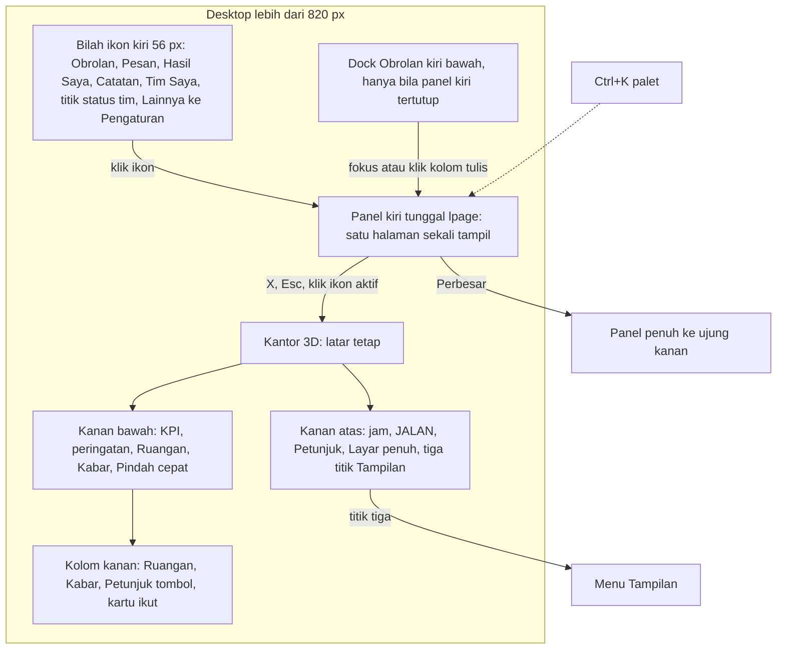

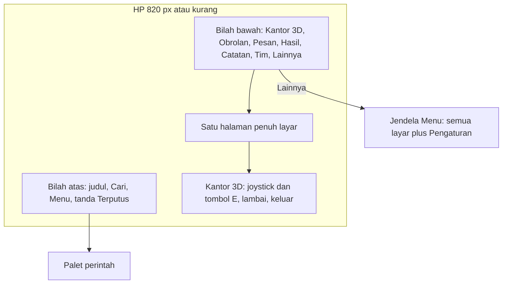

Rute hash [K] (`views.js`, `app.js`):

| Hash | Layar | Muncul di |
|---|---|---|
| `#office` | Kantor 3D | latar desktop; halaman awal desktop |
| `#dashboard` | **Obrolan** (ikon dashboard) | panel kiri; halaman awal HP |
| `#pesan` | Pesan | panel kiri |
| `#tasks` | Hasil Saya | panel kiri |
| `#brain` | Catatan | panel kiri |
| `#team` | Tim Saya | panel kiri |
| `#settings` | Pengaturan | panel kiri (menu Lainnya) |
| `#admin` | Konsol pengelola, 10 tab | tidak ada di menu; hanya platformAdmin |
| `#admin-approvals`, `#admin-studio`, `#admin-knowledge`, `#admin-browser`, `#admin-tasks`, `#admin-team`, `#admin-settings` | alat lama pengelola | lewat tab Alat lama |
| `#chat`, `#admin-chat` | dialihkan ke `#pesan` | |
| `#approvals`, `#studio`, `#knowledge`, `#browser` | dialihkan ke `#admin-*` | |

Parameter hash: `?untuk=ID` dan `?mulai=teks` (Obrolan), `?kontak=ID` (Pesan), `?buka=ID` (Hasil Saya), `?note=ID` dan `?graph=1` (Catatan), `?focus=ID` dan `?nointro` (Kantor 3D) [K]. Hash tidak dikenal diabaikan tanpa pesan. Pindah layar memakai `history.replaceState`, jadi tombol Kembali peramban tidak menelusuri layar.

Urutan pemuatan awal [K]:

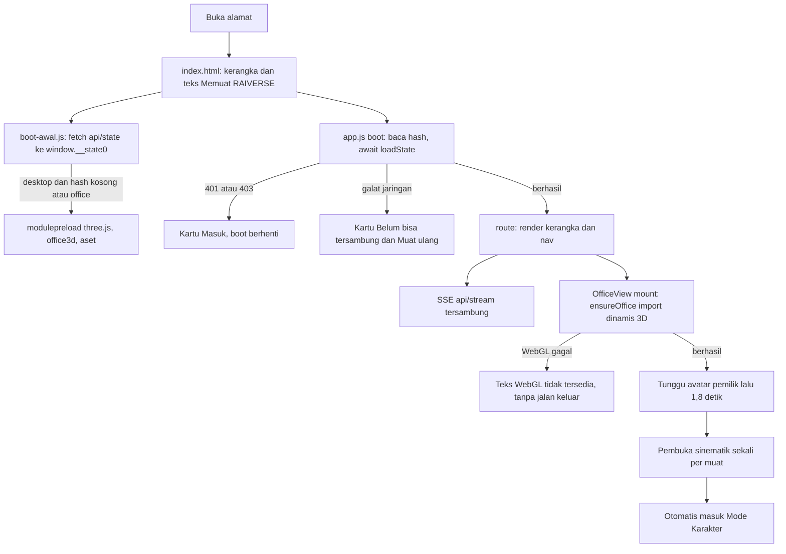

---

## 2. Flowchart logika

### 2.1 Routing penerima pesan chat (urutan nyata di kode)

`chat-engine.js: turnInti`. Dokumen CHAT-ENGINE.md hanya menulis ringkasannya; di kode ada banyak gerbang sebelum router, dan tujuan eksplisit sebenarnya kalah dari beberapa di antaranya [K].

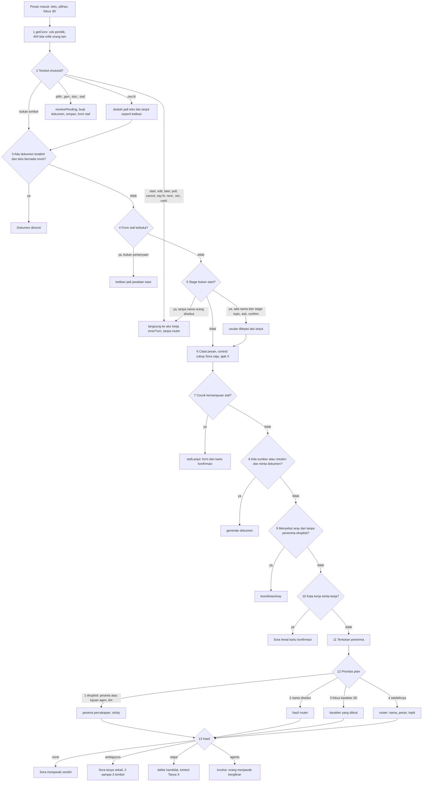

### 2.2 Peran Sora dan aray

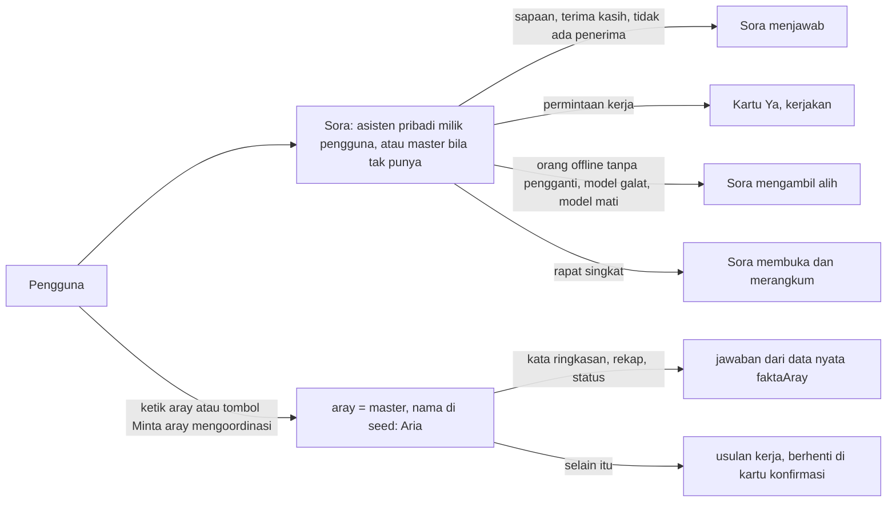

- Nama "Sora" ditulis tetap di teks dan regex, tetapi asisten pribadi tiap pengguna bisa bernama lain (mis. Lumi, Kai) [K]. Bila pengguna tidak punya asisten pribadi, "Sora" sebenarnya master (Aria) [K].
- Pembicara aray tampil tanpa nama (bendera `utama`), sama seperti Sora [K].

### 2.3 Konfirmasi pekerjaan dan eksekusi

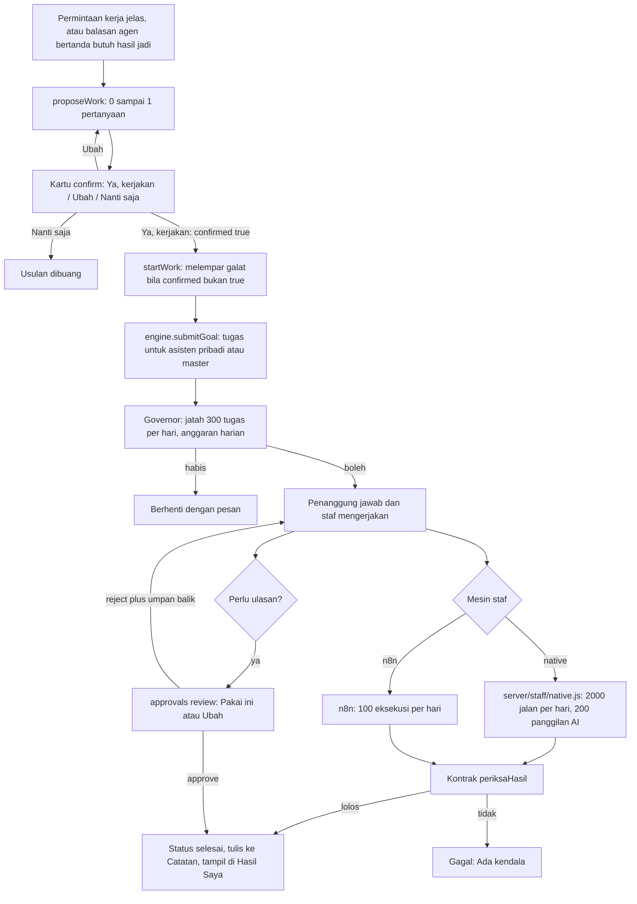

Otomasi (jadwal) punya kartu konfirmasi sendiri, hanya untuk pemilik dan pengelola (`canAutomate`, dipaksa server) [K].

### 2.4 Rapat singkat, rapat panjang, notulensi

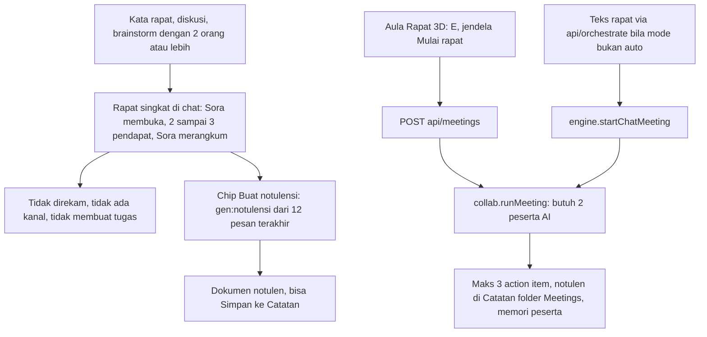

Rapat panjang **tidak** dipicu dari Mesin Chat. `Tutup rapat` di dock lama memakai `/api/orchestrate`, sedangkan `/api/chat/*` mengabaikan rapat yang sedang berjalan [K].

### 2.5 Telegram dan Discord memakai mesin yang sama

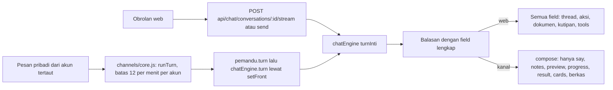

Beda jalur [K]: kanal tidak punya fokus 3D dan streaming, tombol maksimal 8 dan divalidasi ke `link.last.ids`, hasil dipantau tiap 4 detik (maks 150 kali), hanya pesan pribadi, dan memakai kuota `message` yang tidak dipakai chat web.

### 2.6 Mode kursor, karakter, mengetik, sinema

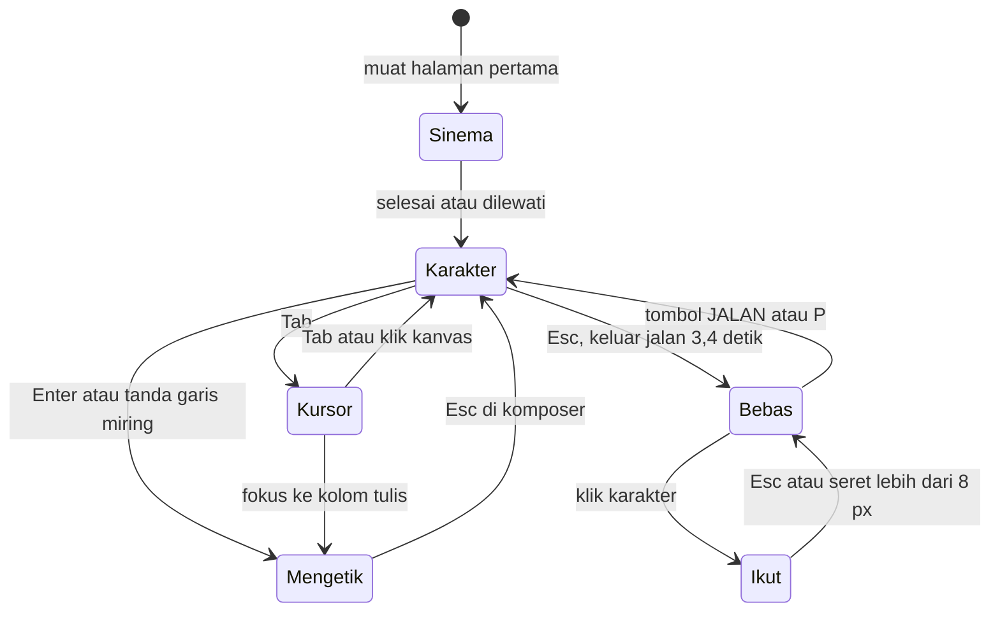

- `mode-kursor.js` adalah mesin keadaan murni; `views.js: pasangModeKursor` menurunkan keadaan dari DOM (fokus input atau pointer lock) dan keadaan tidak disimpan [K].
- Di kamera bebas (di luar Play) Tab berarti "orang berikutnya", artinya berbeda dari Tab di Play [K].
- Sinema hanya pembuka otomatis; "mode bersih" ada di kode tetapi tidak punya tombol pemicu [K].

### 2.7 Pembukaan panel dan kamera

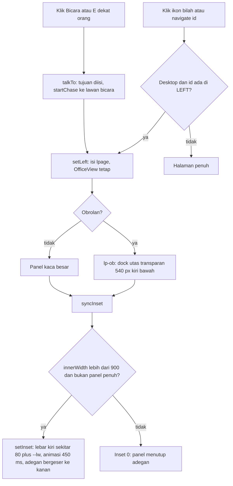

---

## 3. Obrolan (`#dashboard`)

- **Tujuan**: satu percakapan dengan Sora atau orang yang dipilih; sekaligus tempat memberi pekerjaan. Komponen `mountObrolan` di `obrolan-view.js` [K].
- **Tampil di**: desktop sebagai dock-utas kecil di panel kiri (bisa diperbesar), HP sebagai halaman penuh. Komponen yang sama juga dipakai di dalam halaman Pesan.
- **Tata letak (atas ke bawah)** [K]:

| Bagian | Isi |
|---|---|
| Bilah `ob-bar` | judul percakapan (bawaan "Percakapan baru"), tombol Baru, Riwayat, Sumber(n); di 560 px ke bawah hanya ikon |
| Panel Sumber (lipat) | tempel teks, berkas teks, dari Catatan, dari Hasil Saya |
| Layar awal | sapaan dan chip saran dinamis dari server |
| Pita "Pekerjaan ini untuk NAMA" | hanya bila `?untuk=ID`, ada tombol Batal |
| Utas | gelembung pesan, penanda alat, kutipan, langkah kerja |
| Panel Dokumen | di layar 1000 px ke atas menempel kanan selebar paling besar 560 px atau 55%; di compact menutupi komponen |
| Dock bawah | baris kontrol (Ke:, Izin, status), chip peserta, saran @, kotak tulis, kaki "Sisa jatah hari ini" |

- **Tombol dan kontrol** [K]:

| Kontrol | Fungsi |
|---|---|
| Kotak tulis (`Tanya apa saja…`) | tinggi otomatis sampai 160 px; Enter kirim, Shift+Enter baris baru |
| Kirim, lalu berubah jadi Hentikan | membatalkan aliran; bagian yang sudah tampil diberi label "Dihentikan." |
| Mik | hanya bila peramban punya pengenalan suara (id-ID); hasil masuk ke kolom, tidak terkirim otomatis |
| "+" (hanya di panel kiri) | membuka panel Sumber; **bukan** lampir gambar |
| Ke: ... | otomatis "Sora (otomatis)", satu orang, atau "A, B, C +n (rapat)"; maks 4 orang |
| Chip peserta | avatar, nama, titik "bicara", ✕ untuk lepas; chip saran "+ Nama" (maks 2) dan "+ Tambah" |
| @nama | saran lewat `GET /api/chat/saran?q=`; panah, Enter, Tab memilih, Esc menutup |
| Izin | Tanya dulu / Lanjut sendiri / Serahkan penuh (yang terakhir hanya pengelola, ada modal konfirmasi); `PATCH /api/settings {permission}` |
| Status | Sedang menjawab, Tim dijeda, Terhambat, Perlu kamu, N orang bekerja, Siap |
| Baris aksi jawaban | Salin, Ulangi, Minta aray mengoordinasi, Suka, Kurang pas, Buka di panel (jawaban lebih dari 900 huruf) |
| Ubah (pesan pengguna terakhir) | menyunting dan mengirim ulang |
| Chip saran lanjutan | hanya pada balasan terakhir; pilihan ganda tampil sebagai "Pilih salah satu atau ketik jawabanmu"; juga Betul/Ubah, Serahkan ke kamu, Lainnya (ketik), Kembali, Tambah arahan |
| Dokumen | Buka di panel, Unduh (.md), Salin, Simpan ke Catatan (folder Hasil); "Buat dokumen dari ini" menawarkan 7 jenis |
| Riwayat (modal) | cari, tampilkan yang diarsipkan, Ganti nama, Arsipkan atau Pulihkan, Hapus |

- **Alur ketik sampai balasan** [K]:

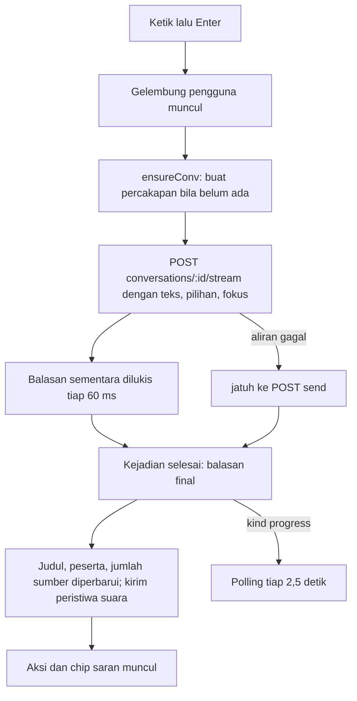

- **Keadaan**:

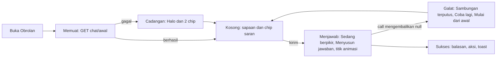

- **API** [K]: `GET /api/chat/awal`; `GET/POST /api/chat/conversations`; `GET/PATCH/DELETE .../:id`; `POST .../:id/stream`, `/send`, `/ulang`, `/ubah`, `/umpan`, `/peserta`, `/tugas`; `GET/POST/DELETE .../:id/sumber`; `GET .../:id/dokumen/:docId`; `GET /api/chat/saran`; `PATCH /api/settings`; `POST /api/notes`. Memori: `GET/PUT /api/pemandu/profile`, `POST /api/pemandu/onboard`.
- **Tautan**: masuk dari Tim Saya (`?untuk`), palet ("Tanya Sora" lewat `?mulai`), tombol F di 3D, Pengaturan (WhatsApp). Keluar ke Catatan (Simpan, Sumber), Hasil Saya (Sumber), Pengaturan Memori.
- **Desktop vs HP**: desktop panel kiri dengan baris kontrol dipindah ke kaki panel; HP halaman penuh dengan jarak bawah 96 px agar tidak tertutup bilah, dan tanpa tombol "+" [K].
- **Keadaan awal**: percakapan baru tanpa penerima (Sora otomatis), izin sesuai pengaturan, tujuan `auto`.
- **Suara**: balasan dibacakan hanya bila Suara asisten Nyala (bawaan Mati); tidak ada tombol "Bacakan" per balasan di Obrolan [K].
- **Memori**: kini di Pengaturan > Memori; dari Obrolan hanya kartu Betul/Ubah yang membuka modal profil.
- **Rapat**: Obrolan tidak punya antarmuka rapat sendiri; bila penerima lebih dari satu, label menyebut "(rapat)" dan server yang mengatur [K].
- **TEMUAN**: T-01, T-13, T-14, T-15, T-18, T-20, T-21, T-22, T-23, T-24, T-41, T-42.

---

## 4. Pesan (`#pesan`)

- **Tujuan**: daftar kontak di kiri dan utas di kanan seperti WhatsApp. Menggantikan `admin-chat` lama (kode `ChatView` sudah dihapus, tinggal komentar) [K].
- **Tata letak** [K]: daftar (judul "Pesan", tombol Grup, kolom cari, filter Semua/Orang/Divisi/Grup/Ruang/Rapat); baris: avatar dan titik status, nama, pin, waktu, cuplikan, lencana belum dibaca; diperbarui tiap 20 detik. Utas kontak: kepala (Kembali, avatar, status, Pin) dan tab Obrolan / Tugas(n) / Info. Lebar elemen 700 px ke atas dua kolom (daftar 290 px), kurang dari itu satu kolom dengan tombol Kembali.
- **Kontrol dan fungsi**:

| Kontrol | Fungsi |
|---|---|
| Grup | modal "Grup baru" (2 sampai 4 orang); ubah nama dan hapus memakai `prompt` dan `confirm` bawaan peramban |
| Tab Obrolan | `mountObrolan(compact, kontak)`: mesin yang sama dengan halaman Obrolan; bar Baru, Riwayat, Sumber disembunyikan |
| Tab Tugas | tugas orang itu |
| Tab Info | info kontak |
| Ruang | dibaca dari data klien; boleh menulis (`POST /api/messages`); tiap pesan ada "Dengarkan" |
| Rapat | hanya baca ("Rapat hanya bisa dibaca…") |

- **Alur**: buka Pesan, pilih kontak, utas terbuka, ketik, balasan lewat Mesin Chat. `#pesan?kontak=ID` membuka langsung; ID tanpa titik dua diberi awalan `orang:`.
- **Keadaan**: daftar kosong (teks "Pilih kontak di kiri" juga muncul di HP yang satu kolom); tidak ada status memuat khusus [K].
- **API**: `GET /api/pesan/kontak?q&jenis`, `GET/POST /api/pesan/kontak/:kid` (`/sesi`, `/baca`, `/pin`), `POST /api/pesan/grup`, `PATCH/DELETE /api/pesan/grup/:gid`, `POST /api/messages` [K].
- **Tautan**: memberi fokus ke karakter 3D (`raiverse:fokus-kontak`); lencana "Menunggu" di dock menuju Hasil Saya.
- **Desktop vs HP**: panel kiri vs halaman penuh.
- **Sudah disatukan?** Mesin: ya, satu Mesin Chat. Antarmuka: **belum**, masih tiga permukaan chat (Obrolan, Pesan, dock lama) [K].
- **TEMUAN**: T-01, T-02, T-25, T-38.

---

## 5. Kantor 3D (`#office`)

- **Tujuan**: ruang kerja utama; karakter AI berjalan dan bekerja, pengguna mengobrol atau memberi pekerjaan. Antarmuka kaca di `views.js: OfficeView`, mesin di `office3d.js` [K].
- **Tata letak** (`office-layout.css`): panel kiri `--lw` = `clamp(380px, 46vw, 520px)` (di 1280 px ke atas `clamp(520px, 50vw, 900px)`); kolom kanan `--colr` 300 px (260 px di 1100 px ke bawah); padding kiri 80 px untuk bilah ikon 56 px [K].

**Toolbar kanan atas** (tinggi 36 px, bulat) [K]:

| Kontrol | Fungsi |
|---|---|
| Jam | popup 260 px: geser 0 sampai 24, Pagi, Siang, Sore, Malam, Otomatis |
| JALAN / KELUAR (Play) | masuk atau keluar Mode Karakter |
| Petunjuk (ikon bantuan, hanya desktop) | kartu 2 kolom 16 pasang tombol, maks 360 px |
| Layar penuh (hanya desktop) | `requestFullscreen` pada kontainer view |
| Tombol Ruangan dan Kabar HP | hanya di HP |
| Tiga titik | menu Tampilan |

**Menu Tampilan (5 item)** [K]: Nama di atas kepala; Gambar dan suasana; Suara dan tombol; Karakter saya; Keadaan tim.
- *Gambar dan suasana* (`#ovis`): tab Utama, Gambar, Atmosfer; preset bawaan dan buatan sendiri; gaya film; bingkai 2,39:1; reset per tab. Tidak ada pilihan cuaca hujan.
- *Suara dan tombol* membuka panel "Pengaturan" (`#ohelp`) yang jatuh ke tab **Navigasi**; tab lain: Mode Karakter, Atur Tombol, Grafis (Otomatis, Hemat, Tinggi), Suara.
- *Keadaan tim*: HUD dengan kalimat status; pengelola mendapat "Rincian teknis".

**Kanan bawah (desktop)** [K]: KPI "N AI", tombol peringatan merah (menuju Hasil Saya), Ruangan, Kabar (lencana belum dibaca), Pindah cepat (V). Di HP seluruh blok ini hilang.

**Kolom kanan** [K]: Ruangan (cari, kelompok, jumlah orang, Lorong; klik memindahkan kamera), Kabar (40 kejadian terakhir), Petunjuk tombol, dan kartu ikut (nama, status, tugas, suasana hati, bar Percaya diri dan Kapasitas, tombol Profil, Bicara, Beri pekerjaan, berhenti; tidak tampil di HP).

**Kartu sementara** [K]: chip konfirmasi tombol, petunjuk dekat orang (E bicara, F beri pekerjaan), pita "Kamu berada di…" 3,8 detik, pil teleport, menu lingkar (Bicara, Beri pekerjaan, Profil, Sapa, Lainnya), joystick sentuh.

**Panel kiri dan dock** [K]:
- Dock `#odock` hanya tampil bila panel kiri tertutup; isinya komposer, Tujuan, Izin, mik, Menunggu(n), Riwayat, Percakapan. Mengirim hanya meneruskan teks ke Obrolan.
- Panel kiri berisi satu halaman (Obrolan, Pesan, Hasil Saya, Catatan, Tim Saya, Pengaturan). Tutup: X, Esc (bila tanpa modal), klik ikon aktif. Perbesar (`#lpfs`): kolom kanan disembunyikan, pilihan diingat per halaman (`ui-penuh-<id>`).
- **Karakter kanan saat ngobrol**: `syncInset` menggeser adegan sebesar lebar kiri (sekitar 80 plus `--lw`, mis. 600 px) dengan animasi 450 ms bila layar lebih dari 900 px dan panel tidak penuh; juga berlaku di mode karakter. Lawan bicara diikuti kamera (`startChase`) dan diberi sorotan [K].

**Mode karakter (Play)** [K]: masuk lewat JALAN atau P dengan sinematik menyelam 5,2 detik; W A S D jalan, Shift lari, Q/R putar, Spasi lompat, G lambai, E bicara atau pakai, F beri pekerjaan, V pindah cepat, M suara, H petunjuk, Tab kursor, Enter atau garis miring ke komposer, Esc keluar (Esc pertama melepas kunci mouse, Esc kedua keluar). Di HP tanpa kunci mouse, dengan joystick area kiri 45%.

**Kamera** [K]: bebas (geser, orbit, zoom, angka 8/5/4/6/2/0), ikut karakter, karakter (zoom 2,2 sampai 14, FOV 38). Otomatis: kamera meluncur ke orang yang mulai bekerja dalam 90 detik setelah pesan dikirim (bila bukan Play dan tidak sedang mengikuti orang lain).

**Aula Rapat** [K]: ruang bernama Conference Hall di kode ("Ruang Rapat" di label); titik "Mulai rapat di sini", E membuka modal (topik, agenda, pemimpin, putaran 1 sampai 3, "Saya mengawali rapat", peserta); `POST /api/meetings`. Peserta duduk, mengangguk, bertepuk saat selesai; layar ruang menyala biru.

**Kehidupan ambien** [K] (`ambien.js`): tiap 1,8 detik (Penuh) atau 3,6 detik (Ringan) agen bebas dalam jarak 46 unit dipilih berkegiatan menurut jam: taman, pantri, bangku, "rapat", baca. Kuota 6 (Penuh), 3 (Ringan), 0 (Mati), di HP maksimal 2. Sapaan ke pemain tiap 14 sampai 30 detik bila jarak kurang dari 7. Diatur di Pengaturan > Tampilan > Suasana hidup (bawaan Penuh di desktop, Ringan di HP). Otomatis mati bila halaman tersembunyi atau ada jendela atau menu V terbuka.

**Popup satu-per-satu** [K] (`office-panels.js`, `maks: 1`): hanya satu dari Ruangan, Kabar, Tampilan, HUD, Pengaturan Kantor, Gambar, Aplikasi, Petunjuk, Pindah cepat, Jam yang terbuka; yang terlama ditutup; klik di luar dan Esc menutup semua. Di luar aturan: dock, panel kiri, kartu ikut, menu lingkar, jendela aplikasi, kartu sementara.

**Jendela aplikasi di 3D** [K]: jendela kaca bisa diseret, diperbesar, `min(1000px, 68%)` kali 74%; saat terbuka gerak dimatikan, render dibatasi sekitar 15 fps dan ambien mati.

**Keadaan**:

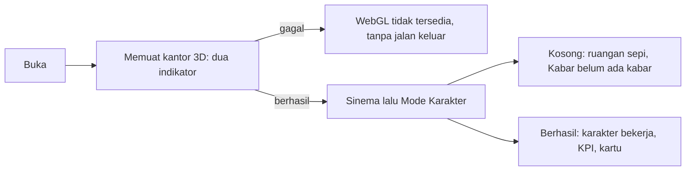

- **API**: `/api/state`, `/api/stream`, `/api/orchestrate` (hanya Tutup rapat), `/api/dm` (dock tersembunyi), `/api/meetings`, `/api/employees` (simpan karakter), `/api/tts`, `PATCH /api/settings` (uiKeys, izin).
- **Tautan**: panel kiri membuka halaman lain; KPI dan peringatan menuju Hasil Saya; Beri pekerjaan menuju Obrolan.
- **Desktop vs HP**: HP tanpa KPI, Pindah cepat, Layar penuh, Petunjuk; tanpa kunci mouse; panel sebagai lembar bawah.
- **TEMUAN**: T-01, T-03, T-04, T-05, T-26, T-28, T-29, T-30, T-31, T-39, T-43, T-44, T-47.

---

## 6. Hasil Saya (`#tasks`)

- **Tujuan**: satu daftar semua pekerjaan: Perlu kamu, Sedang dikerjakan, Selesai [K] `hasil-view.js`.
- **Tata letak**: header, bilah (cari, Mulai pekerjaan, Pilih), bilah massal, daftar tiga kelompok, panel detail. Lebar akar 640 px ke atas: dua kolom (daftar 2fr, detail 3fr, detail menempel); kurang dari itu satu kolom dengan kartu mengembang.
- **Kontrol**:

| Kontrol | Fungsi |
|---|---|
| Cari | menyaring judul, nama, ringkasan |
| Mulai pekerjaan | membuka Obrolan |
| Pilih | mode pilih banyak; kotak centang hanya di kartu bertipe tugas; bilah: Pilih semua, Simpan ke Catatan, Hapus (modal konfirmasi, `POST /api/tasks/hapus-banyak`; yang berjalan atau menunggu izin dilewati), Batal |
| Lihat hasil / Tutup hasil | teks, berkas (Buka, Unduh), tabel maks 50 baris |
| Pakai ini / Ubah sedikit | untuk yang menunggu persetujuan |
| Boleh / Jangan dulu | untuk izin lepas |
| Ulangi, Simpan, Buka di Catatan | tugas biasa |

- **Alur**: ada pekerjaan baru, lencana angka di bilah, buka, kartu terbaru terpilih, Lihat hasil, Pakai ini atau Ubah sedikit (modal "Mau diubah seperti apa?"), Simpan ke Catatan.
- **Keadaan**:

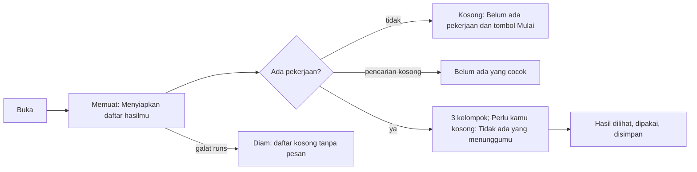

- **API**: `GET /api/staff/runs?limit=30` (disegarkan tiap 30 detik), `GET /api/staff/runs/:id/files/:nama`, `POST /api/approvals/:id`, `PATCH /api/tasks/:id`, `POST /api/tasks/:id/comment`, `POST /api/tasks/hapus-banyak`, `POST /api/notes` [K].
- **Tautan**: Obrolan, Catatan; `?buka=ID`; toast kejadian server menuju sini.
- **Desktop vs HP**: dua kolom bila akar lebar 640 px ke atas, selain itu satu kolom.
- **TEMUAN**: T-16, T-34, T-45.

---

## 7. Catatan (`#brain`)

- **Tujuan**: pustaka catatan seperti Obsidian dan peta hubungan [K] `views.js: BrainView`.
- **Tata letak**: tiga kolom: pohon folder, penyunting atau pembaca, panel kanan (grafik mini, "Catatan yang menautkan ke sini", "Tautan keluar"). Label "Backlinks" sudah diganti. Di HP kiri dan kanan disembunyikan dan dibuka dengan tombol ☰ dan ikon tautan.
- **Kontrol**:

| Kontrol | Fungsi |
|---|---|
| Cari di Catatan | menyaring |
| + | modal Catatan baru (judul, folder bawaan "Knowledge"), langsung mode Ubah |
| Peta hubungan | grafik penuh |
| Rapikan N | `POST /api/brain/organize`: memindah catatan dan mengganti judul **tanpa konfirmasi** |
| Baca / Ubah | simpan otomatis 0,9 detik atau Ctrl+S |
| Lainnya | modal Opsi catatan: folder, tag, **Hapus catatan** langsung menghapus |
| Tautan `[[judul]]` belum ada | modal "Catatan belum ada" lalu Buat catatan |

- **Keadaan**: kosong "Pilih catatan"; tautan balik kosong "Belum ada catatan yang menautkan ke sini"; tidak ada status memuat atau galat khusus (data dari memori klien).
- **API**: `POST/PUT/DELETE /api/notes`, `POST /api/brain/organize`.
- **Tautan**: dari palet (`?note`), Hasil Saya (Buka di Catatan), Obrolan (Simpan, Sumber), Google (Pengaturan).
- **Keadaan awal**: catatan terpin, atau yang pertama.
- **TEMUAN**: T-11, T-35.

---

## 8. Tim Saya (`#team`)

- **Tujuan**: melihat orang AI dan memberi pekerjaan [K] `tim-view.js`.
- **Tata letak**: judul, kolom cari, "Asisten kamu" (kartu besar), lalu satu bagian lipat per divisi (nama, "Penanggung jawab: X", "n sedang bekerja · m orang"), isi: kartu penanggung jawab lalu staf.
- **Kontrol**: cari (membuka semua divisi saat mencari); tiap kartu hanya punya satu tombol, "Beri pekerjaan", ke `#dashboard?untuk=ID`.
- **Keadaan**: kosong "Belum ada yang cocok"; tidak ada status memuat atau galat; divisi tanpa AI disembunyikan.
- **API**: tidak ada (membaca data SSE).
- **Tautan**: Obrolan; kartu orang juga muncul sebagai modal dari palet atau 3D.
- **Desktop vs HP**: grid CSS saja.
- **TEMUAN**: T-36.

---

## 9. Pengaturan (`#settings`)

- **Tujuan**: setelan pengguna biasa. Subjudul: "Cukup empat hal: akunmu, tampilan, ruang kerja, dan sambungan" padahal ada tujuh bagian [K] `pengaturan-view.js`.
- **Navigasi lompat** (7 tautan): Tampilan, Akun, Ruang kerja, Obrolan di ponsel, Memori, Data pribadi, Sambungan.
- **Kartu, urutan persis** [K]:

| # | Kartu | Isi dan tombol | API |
|---|---|---|---|
| 1 | Tampilan | Terang / Gelap; Suasana hidup Penuh / Ringan / Mati; Suara asisten Mati / Nyala; Tes suara | tidak ada (disimpan di peramban) |
| 2 | Akun | foto, nama, email, Keluar; tanpa login: "Kamu memakai ruang kerjamu sendiri" | `GET /api/auth/me` |
| 3 | Ruang kerja dan undangan | peran; Buka ruang lain; Ganti nama (pemilik); daftar orang, peran, Keluarkan; Buat tautan undangan (7 hari) dan Salin | `/api/ws/*` |
| 4 | Obrolan di ponsel | Telegram dan Discord: Hubungkan (kode sekitar 10 menit, Salin, periksa tiap 3 detik), Putuskan tanpa konfirmasi; "WhatsApp belum tersedia" | `/api/saluran`, `/link`, `/unlink` |
| 5 | Memori | Yang aku tahu tentang kamu, Ubah, Kenalkan usahamu dan Catat, Yang kupelajari dengan Hapus tanpa konfirmasi | `/api/pemandu/profile`, `/onboard`, `DELETE /api/belajar/profil/:n` |
| 6 | Data pribadimu | Unduh, Keluar semua (modal), Hapus akunku (ketik HAPUS) | `/api/me/export`, `/sessions/revoke`, `/delete` |
| 7 | Sambungan | Google: Siapkan folder, Kirim Catatan ke Google, Ambil dari Google (polling tiap 2 detik); WhatsApp: tombol "Minta Sora menyambungkan" | `/api/drive/*` |

- **Tidak ada di Pengaturan**: kartu Kualitas grafis dan Karakter saya (keduanya hanya di Kantor 3D, menu Tampilan), kartu Suara terpisah (Suara ada di dalam Tampilan), tautan ke Konsol admin [K].
- **Keadaan**:

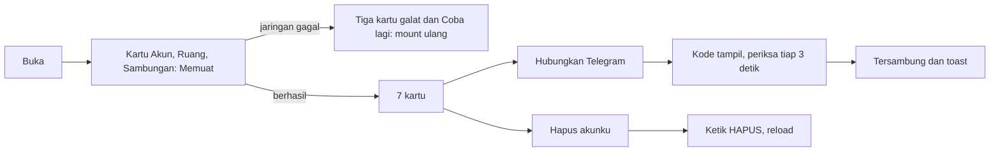

- **Tautan**: Google Drive, Telegram, Discord, Obrolan (WhatsApp).
- **Desktop vs HP**: satu kolom kartu, tautan lompat di atas.
- **TEMUAN**: T-08, T-09, T-10, T-32, T-33, T-40.

---

## 10. Karakter saya (editor robot)

- **Tujuan**: memilih penampilan robot pemain; modal lebar `karakter-view.js: bukaEditorKarakter` dan `mascot-robot.js` [K].
- **Pintu masuk**: **hanya** Kantor 3D, menu tiga titik > Karakter saya. Tidak ada dari Pengaturan atau Tim Saya.
- **Tata letak**: kiri pratinjau kanvas 320 kali 320 (seret untuk memutar), kanan kontrol.
- **Kontrol**: Bentuk robot (4 kartu: Kiko, Azure, Charcoal, Branch), Wajah (Standar, Samudra, Karang), Warna badan (10), Warna aksen (6), Ukuran (0,92 sampai 1,08, hanya tinggi), Acak; tombol Batal dan Simpan karakter.
- **Alur**: buka, Three.js dimuat malas, pratinjau muncul, ubah pilihan (panel digambar ulang, kanvas tetap), Simpan, toast "Karaktermu sudah diperbarui", robot di kantor berubah.
- **Keadaan**: kantor belum dimuat "Pratinjau muncul setelah kantor 3D selesai dimuat"; GL gagal "Pratinjau tidak tersedia di perangkat ini" (editor tetap bisa dipakai); data lama manusia dimigrasi ke robot bawaan.
- **API**: `PATCH /api/employees/:me {appearance: {robot, height}}`.
- **TEMUAN**: T-33; `appearance-ui.js` (editor manusia) masih ada untuk Studio admin dan mungkin yatim bagi pemain (T-28).

---

## 11. Konsol admin (`#admin`)

- **Tujuan**: mengelola platform; hanya `platformAdmin`; tidak ada di menu. Klien mengalihkan non-pengelola ke Obrolan dengan toast; server menolak 403, mewajibkan header `X-Raiverse-Admin`, mencatat audit, batas laju 240 per menit baca dan 40 per menit tulis [K].
- **10 tab** (urutan persis, `admin-view.js`): komentar kode masih menulis 9.

| # | Tab | Isi | Tombol | API (awalan `/api/admin/`) |
|---|---|---|---|---|
| 1 | Ringkasan | kesehatan server, mesin AI, pemakaian hari ini, isi platform, data dan cadangan | tidak ada | `GET ringkasan` |
| 2 | Penyedia AI | kunci Groq dan Anthropic, model per tingkat (6), batas global | Simpan kunci, Uji koneksi, Hapus dari konsol (ketik ulang) | `ai`, `ai/kunci`, `ai/kunci/hapus`, `ai/uji`, `ai/model` |
| 3 | Kuota dan batas | batas per akun, global, laju, anggaran | Simpan perubahan, Bawaan, Tutup atau Buka anggaran | `batas`, `anggaran` |
| 4 | Kesehatan otak | pekerjaan staf nyata, galat, macet, uji nyata | Uji ulang (biaya sampai 0,3 USD, polling 4 detik) | `kesehatan`, `kesehatan/uji` |
| 5 | Pengguna | akun, ruang kerja | Cari, Tangguhkan, Ekspor data, Hapus, halaman | `pengguna`, `/tangguhkan`, `/ekspor`, `/hapus` |
| 6 | Integrasi | Google, n8n, Server MCP, WhatsApp, email | Cek sekarang, Nonaktifkan staf n8n, Uji, Hapus, Tambah MCP | `integrasi`, `/n8n/*`, `/mcp*` |
| 7 | Staf dan katalog | jumlah spesifikasi, mesin staf | Native atau n8n, staffModel | `staf`, `staf/bendera` |
| 8 | Keamanan | log audit, sesi aktif, upaya ditolak, kunci enkripsi | Cabut sesi, Bungkus ulang, Putar kunci | `keamanan`, `/sesi/cabut`, `/kunci/*` |
| 9 | Data | ukuran, cadangan, mode penyimpanan | Buat cadangan, Periksa, Pulihkan (saat server mulai ulang), Bandingkan, Ke dual, Ke sqlite | `data`, `/cadangan`, `/pulihkan`, `/penyimpanan` |
| 10 | Alat lama | 8 tombol ke halaman teknis lama | Pesan, Konfirmasi, Rancang Pembantu, Pusat Belajar, Penjelajah Web, Pekerjaan papan lama, Organisasi, Pengaturan teknis | tidak ada |

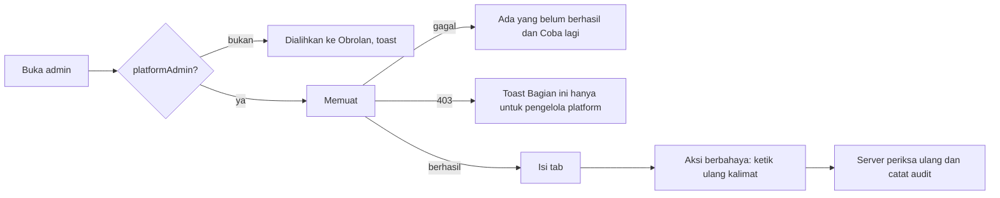

- **Tautan**: Kembali ke Beranda (bertuliskan Beranda, padahal menu menyebut Obrolan); Alat lama menuju `admin-*` dan `pesan`.
- **Desktop vs HP**: tidak ada penyesuaian khusus selain gaya tab.
- **TEMUAN**: T-12, T-37, T-40; jalur pengisian token Telegram dan Discord (`/api/saluran/admin/*`) tidak punya tab.

---

## 12. Masuk dan gerbang

- **Kartu Masuk** [K] `core.js: loginGate`: logo, "Masuk ke RAIVERSE", teks ruang kerja sendiri, satu tombol "Masuk dengan Google" (`/auth/google`), catatan izin. Untuk 403: "Kamu belum menjadi anggota ruang kerja ini" dengan tombol kembali. Muncul juga bila sesi berakhir (401 ber-flag login).
- **Mode lokal** (belum ada yang login, server tidak mewajibkan): kartu tidak muncul, pengguna jadi pemilik dan pengelola platform.
- **Gerbang server** untuk `/api/chat/*` dan lainnya, berurutan [K]: batas per IP, login wajib (401), keanggotaan ruang kerja, batas per akun (600 per menit), izin anggota; kuota harian hanya untuk jenis rute tertentu.

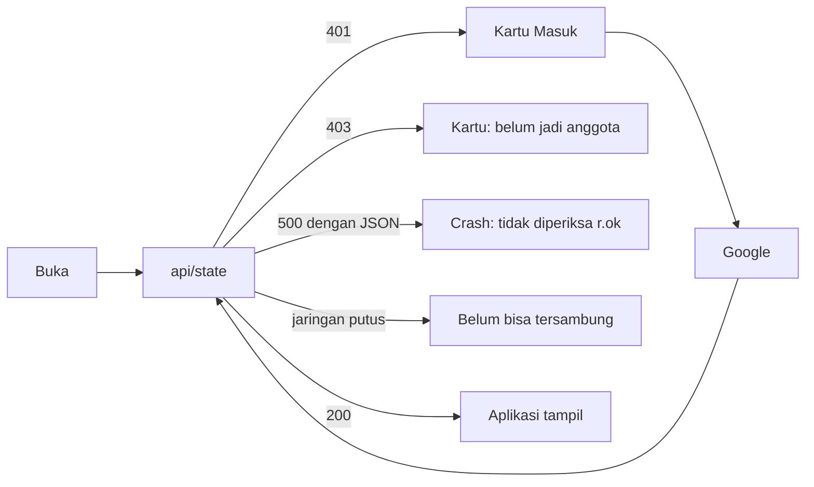

- **TEMUAN**: T-06, T-13, T-40.

---

## 13. Matriks integrasi

### Halaman ke halaman

| Dari \ Ke | Kantor 3D | Obrolan | Pesan | Hasil Saya | Catatan | Tim Saya | Pengaturan | Admin |
|---|---|---|---|---|---|---|---|---|
| Kantor 3D | | dock, F, Beri pekerjaan | fokus kontak | KPI, peringatan, Menunggu | jendela aplikasi | jendela | jendela, menu | |
| Obrolan | klik ikon aktif, Esc | | | Sumber | Simpan, Sumber | | Memori | |
| Pesan | fokus karakter | mesin sama | | Tab Tugas | | | | |
| Hasil Saya | | Mulai pekerjaan | | | Simpan, Buka di Catatan | | | |
| Catatan | | | | | | | | |
| Tim Saya | | Beri pekerjaan | | | | | | |
| Pengaturan | | WhatsApp | | | | | | |
| Palet Ctrl+K | ya | ya, Tanya Sora | tidak ada | ya | ya | ya | tidak ada | |
| Admin | | Kembali | Alat lama | | | | | halaman lama |

### Halaman ke backend

| Halaman | Rute | Server |
|---|---|---|
| Semua | `/api/state`, `/api/stream` | `index.js`, `auth.js` |
| Obrolan | `/api/chat/*`, `/api/pemandu/profile` | `chat-engine.js`, `chat-router.js`, `pemandu-chat.js`, `pemandu.js` |
| Pesan | `/api/pesan/*`, `/api/messages` | `chat-kontak.js` |
| Kantor 3D | `/api/meetings`, `/api/orchestrate`, `/api/dm`, `/api/tts`, `/api/employees` | `engine.js`, `collab.js` |
| Hasil Saya | `/api/staff/runs`, `/api/approvals`, `/api/tasks`, `/api/notes` | `engine.js`, `staff/runner.js`, `staff/native.js`, `approvals.js` |
| Catatan | `/api/notes`, `/api/brain/organize` | `brain.js` |
| Tim Saya | tidak ada | |
| Pengaturan | `/api/ws/*`, `/api/saluran/*`, `/api/drive/*`, `/api/me/*`, `/api/auth/me` | `auth.js`, `channels/*`, `gdrive.js` |
| Admin | `/api/admin/*` | `admin/admin.js`, `keamanan/limits.js`, `platform.js` |
| Telegram dan Discord | memakai `turn()` | `channels/core.js` |

Rute server yatim (tanpa pemanggil di klien) [K]: `GET /api/chat/kabar`, `GET /api/chat/conversations/:id/disarankan`, `GET /api/percakapan`, `POST /api/pemandu/turn`, `GET /api/pemandu/home`, `POST /api/admin/keamanan/sesi/cabut-akun`.

---

## 14. Daftar temuan keliru dan janggal

Tingkat: **Tinggi** (merusak fungsi, keamanan, atau bertentangan keras), **Sedang**, **Rendah**. Kolom Saran adalah usul, belum dikerjakan.

| ID | Tingkat | Halaman | Temuan | Saran |
|---|---|---|---|---|
| T-01 | Tinggi | Obrolan, Pesan, 3D | Tiga permukaan chat: Obrolan, Pesan, dan dock lama `#odock` (komposer, mode Pilihkan/Ngobrol/Kerjakan, Ajak orang, gambar, riwayat). Dock hanya meneruskan teks ke Obrolan, chip penerima dan mode hilang saat kirim [K] | Pensiunkan isi dock, sisakan satu bilah "Tanya apa saja…"; `talkTo` mengisi chip peserta Obrolan |
| T-02 | Tinggi | Pesan, Studio, Divisi | `navigate('chat', {ch})` (`studio.js:234`, `views.js:1417`, `1445`) dialihkan ke Pesan yang hanya membaca `kontak`, jadi `ch` diabaikan dan pengguna mendarat di daftar kosong [K] | Petakan `ch` ke `kontak` (`orang:ID` atau `ruang:div-ID`) |
| T-03 | Tinggi | Kantor 3D | Menu Pindah cepat (V, `#otpm`) ditutup oleh pengatur panel tanpa memanggil `teleportClose`, sehingga W A S D mati, render turun ke sekitar 15 fps, ambien mati, kursor terlepas [K] | `tutup: () => OfficeView.teleportClose()` |
| T-04 | Tinggi | Kantor 3D | Jendela aplikasi menahan `setBlocking(true)`; menutupnya tidak mengunci ulang pointer [K] | `relock()` bila Play |
| T-05 | Tinggi | HP | Bilah bawah punya 7 tombol, grid `repeat(6,1fr)` tinggi 60 px, tombol ke-7 turun baris atau terpotong [K] | 7 kolom, atau 5 tombol plus Lainnya |
| T-06 | Tinggi | Gerbang | `core.js: loadState` tidak memeriksa `r.ok`; respons 500 berisi JSON jadi data lalu crash, bukan kartu "Belum bisa tersambung" [K] | `if (!r.ok) throw` |
| T-07 | Tinggi | Chat, keamanan | `stafJalan` memanggil `runner.run(confirmed:true)` tanpa memeriksa `canAutomate`, sementara `/api/staff/*` dijaga `ownerOnly`; anggota biasa bisa menjalankan staf berdampak keluar lewat tombol "Ya, jalankan" [K] | Tolak bila `!args.canAutomate` |
| T-08 | Tinggi | Pengaturan | Subjudul "Cukup empat hal" padahal tujuh bagian [K] | Hapus hitungan atau sebut ketujuhnya |
| T-09 | Tinggi | Pengaturan | WhatsApp bertentangan: kartu "Obrolan di ponsel" menulis "belum tersedia", kartu "Sambungan" mengajak "Minta Sora menyambungkan" [K] | Satu klaim, satu tempat |
| T-10 | Tinggi | Pengaturan | Sambungan terpecah dan berjauhan: Telegram dan Discord di kartu 4, Google dan WhatsApp di kartu 7; kata "ponsel", "obrolan", "sambungan", "saluran" bercampur [K] | Satu kartu Sambungan dengan sub-bagian |
| T-11 | Tinggi | Catatan | "Rapikan" memindah dan mengganti judul banyak catatan tanpa konfirmasi atau urung; "Hapus catatan" langsung menghapus [K] | Konfirmasi dengan jumlah; urung |
| T-12 | Tinggi | Admin | Rute `keamanan/sesi/cabut-akun` ada di server, tidak ada tombolnya [K] | Tombol di tab Pengguna, atau hapus rute |
| T-13 | Sedang | Kuota | Kuota tidak seragam: `/api/chat/*` tidak punya kuota `message`; `/api/orchestrate` dihitung `task`; Telegram dan Discord dihitung `message`; `generate` menulis dokumen dulu lalu kena kuota tugas 300 per hari (token terbuang bila habis); tiga jatah (tugas 300, n8n 100, staf native 2000) tidak terlihat bersama [K] | Satu aturan kuota untuk semua jalur; cek kuota sebelum memanggil model |
| T-14 | Sedang | Chat | Ketikan di stage `done`, `result`, `work` tidak lewat router: `done` mereset ke Sora; di `result` teks non-pertanyaan jadi revisi (bisa memulai ulang kerja berbiaya, mis. "bagus, sekarang buatkan X"); di `work` ketikan ditelan; "Ya, kerjakan" yang diketik tidak mengonfirmasi dan "ok" malah melepas usulan; `REVISE_RE` memuat `buat(kan)` sehingga "buatkan caption" setelah dokumen dianggap revisi [K] | Konfirmasi bila ambigu; jawab pertanyaan di stage work; samakan ketikan dengan tombol |
| T-15 | Sedang | Chat | Chip `say:N` langsung ke `innerTurn`: lewati router (selalu Sora) dan pesan pengguna tidak dicatat di riwayat [K] | Petakan ke `ces:N` dan catat |
| T-16 | Sedang | Persetujuan | Dua mekanisme: persetujuan staf (`butuh_izin` plus `runner.decide`) terpisah dari `approvals.js` dan di chat hanya tertulis "butuh izinmu" tanpa tombol; persetujuan lewat chat melewati izin `approve` dan tidak membandingkan pengguna dengan penyetuju [K] | Satukan; periksa peran |
| T-17 | Sedang | Rapat | Rapat panjang tak terjangkau dari Mesin Chat; "Tutup rapat" hanya di dock lama lewat `/api/orchestrate`; `/api/chat/*` mengabaikan rapat live; kata "diskusi" biasa dengan 2 target memicu banyak panggilan model [K] | Sambungkan ke Mesin Chat atau hapus janji di dokumen |
| T-18 | Sedang | Sora, aray | Aray tampil tanpa nama; nama master di seed "Aria" tetapi label dan mantra "aray"; "Sora" ditulis tetap padahal asisten pribadi bisa Lumi, Kai; tanpa asisten pribadi "Sora" sebenarnya master [K] | Satu nama; pakai nama asisten pribadi sebenarnya |
| T-19 | Sedang | Chat | Sesi alur kerja dibatasi 40 per ruang kerja dan dipotong menurut waktu tanpa melindungi sesi `work` dan `result`; `goalId` bisa hilang [K] | Lindungi sesi aktif |
| T-20 | Sedang | Suara | Tidak ada tombol "Bacakan" di Obrolan (ada di dock lama dan Pesan-ruang); bacaan otomatis hanya bila Suara asisten Nyala (bawaan Mati); klaim "pesanmu dibacakan" tidak berlaku di Obrolan; balasan di utas Pesan dibacakan walau dibuka manual [K] | Tombol Bacakan di baris aksi; perbaiki teks Pengaturan |
| T-21 | Sedang | Obrolan | Tidak ada lampir gambar di Obrolan; tombol "+" hanya di panel kiri dan hanya membuka Sumber teks, tooltip "lampiran" menyesatkan; tidak ada di HP [K] | Tombol lampir sendiri, atau ganti label |
| T-22 | Sedang | Obrolan, dock | `ctlSegar` mencari `.ob-chip` padahal chip asli `.ob-keping`, jadi `#odwho` selalu "Sora · otomatis"; kontrol ganda (dua select izin) [K, D untuk tampil bersamaan] | Perbaiki selektor, pilih satu set |
| T-23 | Sedang | Jargon | "Minta aray mengoordinasi", "Serahkan penuh", mode "Pilihkan/Ngobrol/Kerjakan", "AI" di KPI, "AGENT" di HUD dan judul tab, label palet `pemandu`, kelas CSS `pm-*` dan API `/api/pemandu/*`, regex `SEBUTAN_LAMA` yang menyamarkan sebutan lama (server masih mengeluarkan), teks Inggris Conference Hall, Library, Sky Deck, Plaza, PLAY [K] | Kamus satu kosakata; ganti label |
| T-24 | Sedang | Penamaan | `#dashboard` berlabel Obrolan berikon dashboard, komentar "Beranda"; Obrolan vs Percakapan vs Pesan vs Kabar vs Keadaan tim vs Jejak aktivitas; merek "RAIVERSE AGENT" vs "RAY AGENT OFFICE"; ikon Pesan garis 20 px (GOLD tak punya kunci `pesan`); komentar "empat layar" padahal enam [K] | Satu nama per hal; tambah ikon emas |
| T-25 | Sedang | Pesan | Di utas kontak, bilah Baru, Riwayat, Sumber hilang, tetapi komposer tetap menampilkan "+ Tambah" peserta dan izin yang tak masuk akal di DM satu orang [K, D] | Sembunyikan di mode kontak |
| T-26 | Sedang | Desktop | Tanda "Terputus" hanya di topbar yang disembunyikan di desktop [K] | Pill di bilah atau HUD |
| T-27 | Sedang | Navigasi | Titik status tim di desktop tanpa label dinamis (title statis, status dan Jatah tak terlihat); di HP tidak ada jeda tim [K] | Title dinamis; pindahkan ke menu HP |
| T-28 | Sedang | Kode mati | Toggle ciut menu dan `navCollapsed` ditulis tak dibaca; 11 dari 18 handler `data-cam` tanpa tombol; CSS yatim; `renderTalk` kosong; umpan "comms" tak terjangkau; `mode-kursor.js` PEMICU tak diimpor; "mode bersih" tanpa pemicu; `appsMenu` tanpa tombol; `appearance-ui.js` mungkin yatim [K] | Hapus |
| T-29 | Sedang | Kantor 3D | Komentar "desktop 2 panel" vs `maks: 1`; kartu Petunjuk (H) mencampur kontrol Play dan bebas dan selalu menulis "Tab: kursor bebas ⇄ kunci" padahal Tab di bebas berarti orang berikutnya; Esc punya tiga lapis penangkap yang terpisah [K] | Satu aturan; petunjuk menurut mode |
| T-30 | Sedang | Responsif | Breakpoint 820 (JS), 900 (CSS, inset), 640 dan 600; tidak ada listener resize; di 821 sampai 900 panel kiri aktif tetapi inset 0 sehingga panel menutup karakter; ukuran berubah tidak memperbaiki struktur sampai pindah layar [K] | Satu konstanta, re-route saat berubah |
| T-31 | Sedang | Kantor 3D | "Suara dan tombol" membuka tab Navigasi bukan Suara; judul panel "Pengaturan" bentrok dengan halaman Pengaturan; tab Mode Karakter tak memuat V, M, Tab, Enter, H [K] | Buka tab Suara; ganti judul |
| T-32 | Sedang | Pengaturan | Nama tautan vs judul kartu beda ("Data pribadi" vs "Data pribadimu"); Suara dalam kartu Tampilan dan "Tes suara" dua baris; "Drive" di SettingsView lama vs "Google" baru; aksi merusak tanpa konfirmasi (Putuskan, Hapus memori, Kirim dan Ambil Google); kalimat konfirmasi beda (HAPUS, HAPUS AKUN SAYA, kalimat admin) [K] | Samakan nama; tambah konfirmasi |
| T-33 | Sedang | Karakter | Editor robot hanya dari Kantor 3D (sulit di HP), tak ada di Pengaturan atau Tim Saya; nama bentuk dan aksen berjargon ("Aksen 3"); "Wajah" hanya varian warna; Simpan aktif tanpa perubahan [K] | Tautan dari Pengaturan; beri nama |
| T-34 | Sedang | Hasil Saya | Mode Pilih hanya tugas (kartu jalan dan izin tak bisa dipilih tanpa penjelasan); "Perlu kamu" mencampur Ada kendala dan Menunggu izinmu, kendala hanya punya Ulangi; muat runs gagal diam; "Ubah sedikit" tanpa persetujuan mengulang dari awal [K] | Pisahkan; keterangan; "Minta revisi" |
| T-35 | Sedang | Catatan | Folder sistem berbahasa Inggris tampil mentah (Company, Playbooks, Knowledge, Deliverables, Notes); teks "31 folder → 3 kelompok" dan "disusun otomatis per Divisi/Jenis"; ikon tautan ambigu [K] | Peta label folder |
| T-36 | Sedang | Tim Saya | Hanya AI yang tampil (anggota manusia tak tampak); satu aksi saja; kosakata beda dengan Organisasi admin; "Sora" tak dikenalkan [K] | Tambah anggota dan profil |
| T-37 | Sedang | Admin | Tab "Kesehatan otak" berjargon (isinya kualitas kerja staf); komentar 9 tab; batas global di tiga tempat; Integrasi dan Staf banyak yang hanya baca; "Nonaktifkan staf n8n" menggantung (skrip belum ada); SettingsView lama duplikat; jargon webhook, SSRF, MCP, sqlite [K] | Ganti nama; satukan |
| T-38 | Rendah | Pesan | "Pilih kontak di kiri" salah di HP; "+ Grup" padahal berlabel Grup; `prompt` dan `confirm` bawaan peramban; lencana ruang dan rapat selalu 0, daftar terbatas 80 [K] | Perbaiki teks; pakai `modal()` |
| T-39 | Rendah | 3D | Galat WebGL tanpa jalan keluar dan memakai kata teknis; dua indikator memuat; KPI, Pindah cepat, Layar penuh hilang di HP [K] | Tombol "Buka Obrolan" |
| T-40 | Rendah | Pesan galat | Penolakan admin menyebut "pemilik ruang kerja" padahal syaratnya pengelola platform [K] | "pengelola platform" |
| T-41 | Rendah | Telegram | Pada `needsWork` jawaban agen tidak terkirim (hanya `say`); field `thread`, `aksi`, `dokumen`, `kutipan`, `tools` tak ditampilkan di kanal; 404 permanen setelah akun luar ditautkan ke pengguna lain [K] | Susun `compose` ulang |
| T-42 | Rendah | Dokumen | CHAT-ENGINE.md basi: alat tertulis dua padahal lima; `/api/percakapan` disebut dipakai Kantor 3D padahal tak ada pemanggil; baris 56 dan 119 bertentangan; rute yatim [K] | Perbarui dokumen |
| T-43 | Rendah | Keamanan kecil | `window.__ray3d` terbuka untuk semua; `staf:ya` tak kedaluwarsa; `resolvePending` tidak memvalidasi id; peserta sticky tak pernah menyusut [K] | Batasi |
| T-44 | Rendah | Tema, rute | Kilatan terang saat awal (tema dipasang setelah modul); hash LEGACY tidak dinormalisasi; tombol Kembali tak bekerja; `theme-color` satu nilai [K] | Pasang tema di head |
| T-45 | Rendah | Label | "Hasil saya" vs "Hasil Saya" vs "Hasil" [K] | Samakan |
| T-46 | Rendah | Duplikat | Riwayat dan Baru ganda di dock, Ruangan dan Kabar ganda, menu HP ganda, dua pendengar `blur` identik, dua `z-index` 30 yang saling menumpuk, tiga kartu sementara menumpuk di kanan atas [K] | Rapikan |
| T-47 | Rendah | Dugaan | Esc keluar-jalan bisa sekaligus menutup panel kiri; intro sinematik otomatis masuk Mode Karakter dan mungkin menangkap tombol saat mengetik di panel [D] | Uji di layar |

**Belum diverifikasi di layar**: seluruh dokumen ini. Terutama yang berstatus [D] (T-22 sebagian, T-25, T-47), perilaku Esc, bilah bawah HP, dan tampilan panel kiri dan inset di berbagai lebar.

## 15. Status temuan setelah konsolidasi (2026-11-20)
Penilaian terhadap kode terkini: `docs/FUNDAMENTAL/konsolidasi/NILAI-47-TEMUAN.md`. Diperbaiki: T-06, T-07, T-08, T-09, T-11 (Rapikan), T-22, T-45. Lainnya masih terbuka (T-03/T-04 menyangkut kunci pointer 3D, sengaja tidak disentuh). Bagian 14 tetap sebagai catatan asal.
