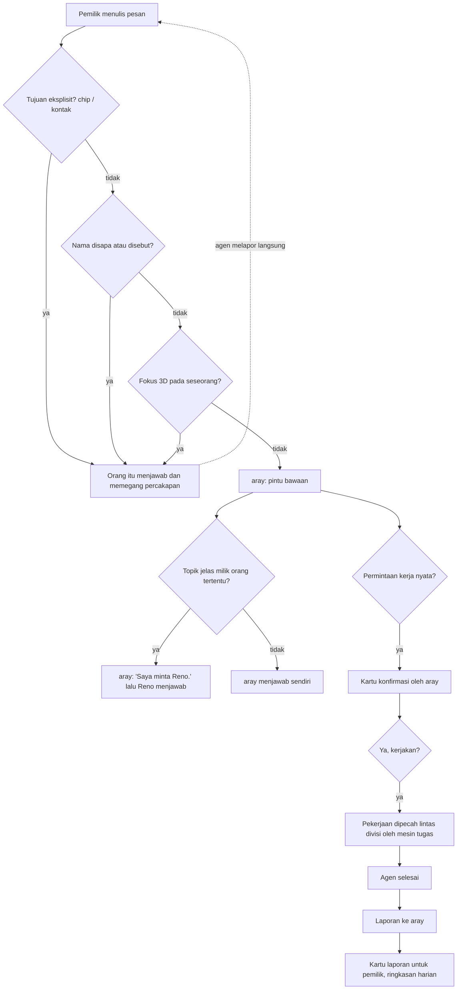

# Perilaku obrolan RAIVERSE

Dokumen ini menjelaskan **cara obrolan berpikir, membalas, memakai alat, mengingat, dan dinilai**. Kode dan dokumen berjalan seiring: bila kamu mengubah perilaku, ubah `server/otak/perilaku-obrolan.js` (satu-satunya tempat prompt dirakit) dan dokumen ini.

Diperbarui 2026-11-19. Mesin obrolan: [CHAT-ENGINE.md](CHAT-ENGINE.md). Peta modul: [PETA-BACKEND.md](PETA-BACKEND.md).

## 1. Satu sumber perilaku

| Hal | Di mana |
|---|---|
| Prinsip jawaban, aturan kolom, protokol alir, prompt dokumen, prompt ringkasan | `server/otak/perilaku-obrolan.js` (`bangunSistem`, `sistemDokumen`, `SISTEM_RINGKAS`) |
| Siapa yang berbicara (persona, peran, keahlian) | `server/chat-engine.js` (`personaOf`, `paPersona`), `server/pemandu.js` (Sora) |
| Tingkat model per tugas (cepat/pintar), penyedia | `server/otak/penyedia-chat.js` |
| Putaran alat, penghitung, verifikasi angka, kompaksi | `server/pemandu-chat.js` (`reply`, `hitungAman`, `angkaTakBerdasar`, `ringkasPercakapan`) |
| Rubrik penilaian mutu | `server/otak/evaluasi-obrolan.js` + `test/fixtures/obrolan-uji.json` |

Semua yang berbicara di obrolan (asisten utama, tiap orang/staf, penulis dokumen, saluran Telegram dan Discord) memakai **prinsip yang sama**. Persona hanya ditambahkan di depan: "Kamu Hendra, Kepala Keuangan..." lalu prinsip yang sama berlaku.

Pengecualian jujur: pekerjaan panjang yang dijalankan **mesin tugas** (`server/engine.js`, agen yang mengerjakan pekerjaan setelah konfirmasi) memakai prompt perannya sendiri, belum memakai berkas ini. Itu sebagian: lihat tabel kemampuan di bawah.

## 2. Sembilan prinsip jawaban (ditambah dua aturan konteks)

1. **Langsung ke inti.** Kalimat pertama sudah menjawab; tidak mengulang pertanyaan; tidak minta maaf berlebihan.
2. **Jujur.** Tidak mengarang angka, laporan, nama, atau sumber. Tidak tahu = bilang, dan sebut data apa yang dibutuhkan. Sebut asal informasi (sumber [n], catatan, hasil alat, pengetahuan umum).
3. **Panjang sesuai pertanyaan.** Sapaan satu kalimat; hal rumit terstruktur (judul/daftar/tabel) dan ditutup ringkasan.
4. **Rekomendasi tegas.** Satu pilihan terbaik di kalimat pertama, alasan singkat, kapan alternatif lebih cocok.
5. **Klarifikasi hanya bila perlu.** Satu pertanyaan dengan 2 sampai 4 pilihan; bila bisa dijawab dengan asumsi wajar, jawab dan sebut asumsinya.
6. **Nada hangat, Indonesia sehari-hari**, tanpa istilah teknis internal (daftar terlarang di `server/kamus.js`, diuji otomatis).
7. **Alat hanya bila perlu**; jangan bilang selesai sebelum hasil alat dibaca dan dicocokkan; alat gagal dikatakan jujur.
8. **Tidak berjanji** mengerjakan yang belum diminta; hal berdampak ke luar selalu ditanyakan dulu (dan dijaga di kode, bukan hanya di prompt).
9. **Saran lanjutan** 2 sampai 4, spesifik, paling banyak enam kata.
10. *(konteks)* Pengguna menjalankan usaha; istilah ganda (margin, modal) ditafsirkan sebagai arti bisnis.
11. *(konteks)* Data milik pengguna yang tidak ada dibilang belum ada, tanpa pertanyaan yang tidak perlu.

Prompt **tidak** menggantikan pagar kode. Pagar tetap di kode: pekerjaan tidak bisa dibuat tanpa tombol "Ya, kerjakan" (`startWork`), kemampuan staf berdampak wajib kartu konfirmasi, kata terlarang diganti (`rapikan`), kutipan diperiksa terhadap sumber.

## 3. Mesin agen: rencana, aksi, amati

`pemandu-chat.reply` menjalankan putaran:

1. Model merencanakan: `alat` + `kueri` (+ `tambahan`: alat lain yang **bebas** satu sama lain).
2. Alat dijalankan **bersamaan** (paling banyak 3), hasilnya dibaca model, yang boleh memakai satu alat lagi bila masih kurang.
3. Paling banyak **4 langkah**; **anggaran biaya per giliran** 0,06 USD (diukur dari pemakaian model sungguhan; lewat dari itu putaran berhenti dan jawaban memakai yang sudah ada, dengan catatan jujur).
4. Sebelum jawaban dikirim, **verifikasi aturan** (tanpa model): (a) alat gagal tetapi jawaban tidak mengakui, ditambah catatan jujur; (b) angka penting di jawaban (persen, rupiah, ratusan ke atas) harus ada di pesan pengguna, profil, sumber, ringkasan, atau hasil alat. Bila tidak, model diperiksa ulang **satu kali** dan, bila tetap tanpa dasar, jawaban diberi catatan "belum bisa kupastikan".

Alat yang tersedia lewat satu pintu kecil: `catatan` (Catatan/Second Brain), `web` (pencarian, hanya Groq), `sumber` (cari bagian sumber lampiran), `hitung` (penghitung aman: hanya angka dan + - * / ( ) %, diurai tanpa `eval`), `staf` (mencari kemampuan khusus; menjalankannya lewat alur konfirmasi di `chat-staf.js`). Pembuatan dokumen lewat tombol "Buat dokumen dari ini". Penanda langkah (`tools[]`: label, detail, `ok`, `langkah`) tampil di antarmuka sebagai baris "Selesai · N langkah" yang bisa dibuka.

Batas jujur: alat browser (Chrome) belum menjadi alat obrolan; kemampuan staf dari obrolan hanya terpicu oleh permintaan berangka dengan kata kerja hitung/susun/cek dan lolos pagar relevansi (satu kata umum seperti "berapa" tidak cukup).

## 4. Memori dan konteks

- **Kompaksi otomatis.** Setelah 24 pesan, bagian lama (kecuali 10 pesan terakhir) diringkas model kecil (5-8 poin: pokok bahasan, angka/nama penting, yang sudah dikerjakan, yang ditunggu) lalu disimpan di `conv.ringkasan` dan dimasukkan ke prompt. Riwayat lengkap tetap tersimpan untuk pengguna. Tanpa model, ringkasan cadangan berupa potongan pendek tiap pesan.
- **Memori pengguna** (profil: nama, kebiasaan, preferensi) bisa dilihat dan diubah di **Pengaturan > Memori** (`memori-view.js`), dan dipakai di prompt ("Yang kamu tahu tentang pengguna").
- **Second Brain / Catatan** sebagai pengetahuan lewat alat `catatan`; **sumber lampiran** (maksimal 8 per percakapan) lewat alat `sumber` dan blok sumber bernomor, dengan kutipan yang diverifikasi.

## 5. Antarmuka (setara pola Claude/ChatGPT)

| Fitur | Keadaan |
|---|---|
| Markdown penuh (judul, daftar, tabel, kode dengan tombol Salin, tautan) | Ada (`public/js/md.js`) |
| Streaming kata demi kata | Asli di Groq; penyedia lain: jawaban dipotong dari hasil utuh |
| Indikator "Sedang berpikir / Menyusun jawaban" + titik berdenyut | Ada |
| Langkah yang dikerjakan, bisa dibuka (berhasil / belum berhasil) | Ada |
| Panel dokumen di samping (di layar sempit menutupi obrolan) dengan Salin, Unduh, Simpan ke Catatan | Ada (dokumen jadi, hasil pekerjaan, jawaban panjang) |
| Ulangi jawaban, Salin, Membantu / Kurang pas | Ada (`/ulang`, `/umpan`) |
| Ubah pesan sendiri (pesan terakhir; jawaban diganti) | Ada (`/ubah`) |
| Hentikan jawaban (tombol Kirim berubah jadi Hentikan) | Ada; bagian yang sudah tampil dipertahankan |
| Saran lanjutan, pilihan ganda | Ada |

Batas: Ulangi/Ubah hanya untuk obrolan biasa (bukan pesan yang memicu usulan kerja, dokumen, atau pekerjaan berjalan); mengubah pesan lama (bukan yang terakhir) belum didukung. Hentikan memutus tampilan; server bisa selesai menyusun jawaban dan menyimpannya di riwayat.

## 6. Penyedia model dapat diganti

`penyedia-chat.js` memetakan dua tingkat ke penyedia aktif (konsol pengelola, `llm.provider()`):

| Tingkat | Dipakai untuk | Groq (sekarang) | Claude (bila kunci diisi pengelola) |
|---|---|---|---|
| cepat | sapaan, obrolan ringan, isi formulir, kompaksi | gpt-oss-20b | model kecil Claude |
| pintar | pertanyaan rumit (bandingkan, langkah, risiko, strategi, >40 kata), dokumen | gpt-oss-120b | model besar Claude |

Obrolan **tidak menyimpan atau meminta kunci sendiri**. Bila pengelola mengisi kunci Anthropic di konsol pengelola dan memilih Claude, tingkat berpindah otomatis. Jalur Claude diuji dengan model tiruan dan pemetaan nama; **belum pernah dijalankan dengan kunci Claude sungguhan** di repositori ini.

## 7. Penilaian mutu

`scripts/evaluasi-obrolan.mjs` menjalankan 33 percakapan (`test/fixtures/obrolan-uji.json`; 11 kategori: sapaan, pengetahuan umum, diskusi, rumit, kejujuran, sumber, alat catatan, alat hitung, permintaan kerja, pancingan eksekusi, multi-giliran) di folder data **sementara**, dengan rubrik aturan (0 sampai 1): ketepatan, kejujuran, kejelasan, penggunaan alat, kepatuhan konfirmasi.

```bash
node scripts/evaluasi-obrolan.mjs --versi baru --batas 0.1      # model asli (kunci dari .env, tidak dicetak)
node scripts/evaluasi-obrolan.mjs --versi lama --batas 0.1      # perilaku lama sebagai pembanding (RAY_PROMPT_OBROLAN=lama)
node scripts/evaluasi-obrolan.mjs --tiruan                      # tanpa biaya: hanya memeriksa pipa
```

Hasil per percakapan ada di `docs/uji-nyata/obrolan-*.json`.

### Hasil (model asli gpt-oss-20b/120b di Groq, 2026-11-19, biaya total tiap putaran sekitar 0,005 USD)

| Putaran | Ketepatan | Kejujuran | Kejelasan | Alat | Konfirmasi | Total |
|---|---|---|---|---|---|---|
| Perilaku lama | 0,90 | 0,75 | 0,97 | 1,00 | 1,00 | 0,93 |
| Perilaku baru, putaran 1 | 0,89 | 1,00 | 0,98 | 0,87 | 1,00 | 0,95 |
| Perilaku baru, putaran 2 (ulang, kode sama) | 0,88 | 0,75 | 0,94 | 0,93 | 1,00 | 0,90 |

**Bacaan jujur:** dua putaran dengan kode yang sama berselisih 0,05, sama besar dengan selisih lama vs baru. Jadi **tidak ada bukti peningkatan mutu yang terukur** pada model ini; yang terlihat hanya variasi antarputaran. Hal yang pasti membaik adalah yang bisa dibuktikan tes kode: jawaban hitung kini tepat lewat alat, angka tanpa dasar diperiksa ulang, pembajakan kemampuan staf pada pertanyaan hitung tertutup, dan kepatuhan konfirmasi 1,00 di semua putaran (pagar ada di kode). Catatan metode: rubrik dan prompt baru disetel setelah melihat kegagalan putaran pertama pada 33 percakapan yang sama (risiko menyesuaikan diri dengan uji); rubrik hanya aturan, bukan penilaian manusia.


## 8. Apa yang TIDAK bisa identik dengan Claude

Kode ini bisa membuat obrolan **berperilaku seperti Claude** (langsung ke inti, jujur, memakai alat, mengakui batas, antarmuka setara). Ia **tidak bisa membuat model gpt-oss setara kemampuan Claude**:

- **Penalaran dan kepatuhan instruksi** model kecil lebih lemah: format kadang meleset (keluaran kosong sekitar sepertiga panggilan alir di uji, ditangani dengan ulang otomatis), jawaban rumit cenderung pendek walau diminta rinci.
- **Mengarang angka** masih terjadi sesekali pada model kecil. Verifikasi aturan menangkap sebagian (angka yang tak ada di data), bukan semua klaim salah (fakta kualitatif yang keliru tidak terdeteksi).
- **Konteks panjang dan konsistensi** berbeda; kompaksi membantu tetapi tidak menyamai konteks besar Claude.
- Penilaian aturan tidak sama dengan penilaian manusia; skor tinggi di rubrik **bukan bukti kesetaraan**. Kesetaraan mutu hanya dapat diklaim setelah model kelas Claude dipasang (kunci diisi pengelola) dan dinilai manusia pada percakapan nyata.

## 9. Peran aray (kembaran digital) dan Sora (keputusan Owner 2026-11-20; menggantikan arahan peran sebelumnya)
Fungsi Obrolan: tempat pemilik berbicara dengan siapa pun dengan mudah.

- **aray** = orkestrator utama = **kembaran digital pemilik** (bertindak atas nama pemilik dalam batas izin, membawa preferensi, memori, dan gaya pemilik). Ia **pintu bawaan**: tanpa target, pesan menuju aray. aray memutuskan sendiri: menjawab sendiri (umum, koordinasi, tentang pemilik, sapaan) atau meneruskan ke orang yang tepat dengan **satu kalimat singkat** ("Saya minta Reno."), lalu orang itu menjawab dengan nama dan perannya sendiri. aray memecah tujuan, mendelegasikan, memantau, menyatukan hasil, membuat notulensi dan pengingat, dan **melapor**.
- **Bicara langsung:** klik karakter, chip, "@nama", kontak di Pesan, atau fokus 3D: orang itu yang menjawab dan memegang percakapan; **aray tidak menyela**, dan orang itu melapor langsung ke pemilik.
- **Sora** bukan lagi persona pembicara. Fungsinya (notulensi, jadwal, pengingat, persetujuan menunggu) dilebur ke kemampuan aray. Entitas Sora tetap ada di data (id `pa-owner` tidak diubah: sumber bentuk, warna, suara, dan dipakai mesin tugas serta tes; ia boleh duduk di meja asisten sebagai sekretaris tanpa jalur chat) tetapi tidak muncul sebagai penerima, kontak, saran "@", atau teks layar. `pemandu.paOf` kini mengembalikan aray.
- **Routing per pesan:** tujuan eksplisit (chip, kontak) > nama disapa atau disebut > fokus 3D > (bawaan) aray. Catatan keputusan: urutan dari Owner menaruh fokus 3D di atas nama; nama yang disapa jelas ("tanya Maya", "@Maya", "halo kamu Reno") tetap saya taruh di atas fokus karena itu juga target yang dipilih pengguna sendiri; mudah dibalik bila ingin.
- **Pekerjaan nyata** selalu lewat kalimat konfirmasi dan tombol "Ya, kerjakan" (pagar kode di `pemandu.startWork`), diucapkan aray. `@aray` + kata kerja koordinasi (koordinasikan, susun, siapkan, luncurkan, ...) mengusulkan pekerjaan lintas divisi; `@aray ringkasan` memberi ringkasan dari fakta nyata (`faktaAray`); `@aray apa kabar` hanya dijawab aray.



**Model laporan (agen → aray → pemilik):** tidak ada data ganda. Kartu laporan diturunkan dari pekerjaan yang selesai (`chat-engine.laporan`, `GET /api/chat/laporan`): hasil pecahan aray dilaporkan aray dengan daftar **agen sumber** yang bisa ditelusuri; pekerjaan satu orang dilaporkan orang itu lewat aray. Hanya tanda "sudah dibaca" yang disimpan (`db().chat.laporanDibaca[userId]`, `POST /api/chat/laporan/:id/baca`). Tampil di Pesan: kontak aray, tab **Laporan** dengan tombol "Telusuri <nama>". Ringkasan harian/mingguan: `@aray ringkasan`. Notulensi: tombol "Buat notulensi" (kartu: kesimpulan, keputusan, tugas lanjutan; Simpan ke Catatan atau "Jadikan tugas" yang berhenti di konfirmasi), dibuat aray.

**Contoh percakapan**
1. Tanpa target: "gimana strategi promosi minggu depan?" → aray: "Saya minta Maya." → Maya (Head of Marketing) menjawab sendiri.
2. Langsung: "@reno kamu ahli apa" → Reno: "Aku Reno, Digital Marketing Strategist; fokusku funnel dan atribusi." (aray diam).
3. Umum: "bagaimana cuaca besok?" → aray menjawab sendiri.
4. Kerja: "tolong buatkan caption promo kopi" → aray: kartu "Mau aku kerjakan sekarang?" → pekerjaan hanya setelah "Ya".
5. Laporan: pekerjaan peluncuran selesai → kartu di Pesan > aray > Laporan: "Peluncuran siap ..." dengan "Telusuri Hendra", "Telusuri Maya".

Prompt: `perilaku-obrolan.js` `PERSONA_ARAY` (satu sumber): kembaran digital, orkestrator, jujur, tidak mengarang, tidak mengambil alih percakapan langsung. Telegram/Discord memakai mesin yang sama (pintu bawaan aray, nama disebut tetap dikenali).

Belum: pengingat jadwal dan persetujuan menunggu oleh aray baru tampak sebagai status komposer dan kartu laporan, belum pesan proaktif; "membawa memori pemilik" memakai profil/Memori yang ada (belum penalaran gaya khusus); kartu laporan belum muncul di Kabar 3D; sekretaris Sora di meja 3D belum diubah perannya di data.

## 10. Jawab dulu (kasus "@reno kamu algi apa")
Akar masalah ganda: (1) awalan "@" belum dihitung sebagai isyarat menyapa, sehingga nama pendek seperti "@reno hai" jatuh ke Sora; (2) model menafsirkan "algi" sebagai "algoritma" lalu memberi menu. Perbaikan: router mengenali "@nama", "kmu", salah eja nama pendek yang jelas disapa; pertanyaan tentang diri (`TANYA_DIRI`) mendapat perintah khusus (tafsirkan salah ketik, jawab dari peran dan keahlian di profil, tanpa menu, tanpa mengarang pengalaman, jam kerja, atau angka); prinsip 5 menjadi **JAWAB DULU**; pagar kode: menu kaku (`menuKaku`) ditolak dan dijawab ulang sekali, angka karangan diganti pengakuan "belum ada di profilku". Pilihan hanya sebagai saran lanjutan di akhir.
